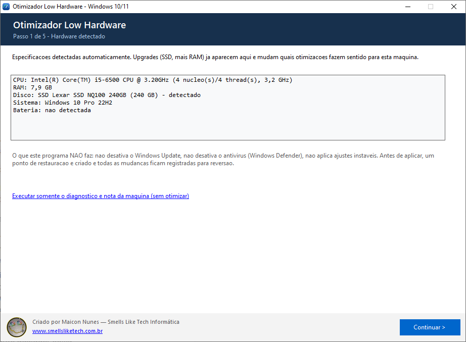
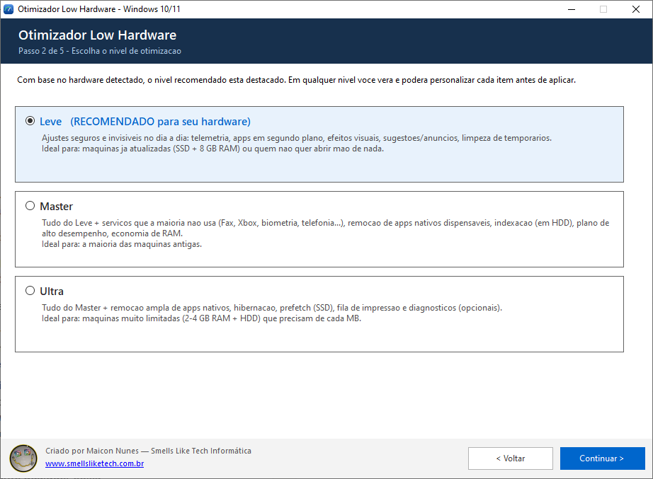
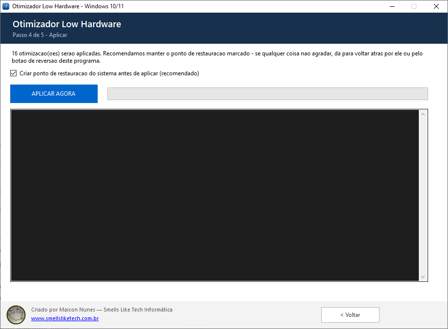

# Otimizador Low Hardware

Ferramenta de bancada para Windows 10/11 que detecta o hardware do computador, recomenda um nível de otimização e aplica ajustes de forma **explicável, selecionável e reversível**.



## O problema

Computadores antigos ou de entrada não devem receber o mesmo conjunto de ajustes. HDD, SSD, quantidade de RAM, CPU e versão do Windows mudam o que faz sentido otimizar.

O programa analisa a máquina antes de recomendar qualquer perfil.

## Principais recursos

- detecção de CPU, RAM, armazenamento, bateria e versão real do Windows;
- identificação de HDD/SSD por múltiplas estratégias;
- perfis Leve, Master e Ultra;
- catálogo de otimizações condicionado ao hardware;
- seleção item a item antes de aplicar;
- captura do estado anterior para permitir reversão;
- ponto de restauração;
- diagnóstico de memória e disco;
- benchmark de CPU, RAM e armazenamento;
- relatório e nota de 1 a 10 para a máquina.

## Stack

C# 5 · .NET Framework 4.x · WinForms · WMI · Registry API · ServiceController · P/Invoke Win32

A limitação a C# 5 é deliberada: o projeto compila com o `csc.exe` disponível no próprio Windows, sem Visual Studio, SDK ou NuGet.

## Decisões de engenharia

### Windows 11 pelo número de build

O programa não depende apenas de `ProductName`. A versão é inferida pelo build (`>= 22000`) para evitar identificar Windows 11 como Windows 10.

### Benchmark de disco sem cache

A medição de leitura 4K usa `CreateFileW` com `FILE_FLAG_NO_BUFFERING`. O buffer é alocado com alinhamento adequado via `VirtualAlloc`, evitando que o cache de páginas transforme o teste de disco em teste de RAM.

### Reversão baseada no estado real

Cada ação sabe capturar o estado anterior imediatamente antes da alteração. O arquivo de undo registra esse estado e a reversão executa as ações em ordem inversa.

### Catálogo declarativo

As condições de aplicabilidade pertencem aos próprios itens do catálogo. A interface apenas filtra o que é compatível com o hardware detectado.

## Fluxo

1. detectar hardware;
2. recomendar perfil;
3. revisar e personalizar ajustes;
4. aplicar com log e captura de undo;
5. executar diagnóstico e gerar relatório.

| Perfil | Aplicação |
| --- | --- |
|  |  |

## Como compilar

No Windows:

```bat
build.bat
```

O executável é gerado sem exigir Visual Studio ou instalação de SDK.

## Segurança e transparência

O software altera serviços e configurações do Windows, portanto requer privilégios administrativos. O código é público justamente para permitir auditoria do que é aplicado e como cada alteração é revertida.

## Autor

**Maicon Nunes** — Smells Like Tech Informática  
[GitHub](https://github.com/mikerock12) · [Site](https://www.smellsliketech.com.br)


## Portal e publicações

Demonstração, recursos e download da última versão: [Softwares SLT](https://softwares.smellsliketech.com.br/apps/otimizador/).

Cada merge em `main` passa pelo CI e gera uma nova release estável com SHA-256. O portal consulta a release mais recente automaticamente (cache de até cinco minutos). Código-fonte é mantido neste repositório; o projeto central apenas o referencia como submódulo.

### Melhorias 1.1

Reversão gravada atomicamente antes de cada ação, inclusive falhas parciais; itens que falham ao reverter permanecem disponíveis para nova tentativa. Comandos drenam stdout/stderr em paralelo e códigos de erro são propagados. Valores de registro expansíveis preservam as variáveis originais. A compilação usa UTF-8.

### Correções 1.2 — 25/10/2026

- Desinstalação Appx por nome completo, com preferência pelo bundle pai. Se a remoção
  global falha (incluindo `0x80070002`), consulta os perfis que têm a instalação e tenta
  remover por perfil. Uma consulta final confirma a ausência antes de registrar sucesso.
- Apps ausentes ou somente preparados não geram falsa falha. Componentes protegidos
  são mantidos e avisados; falhas reais continuam no resumo, com códigos do Windows.
- O arquivo de reversão não reinstala apps removidos. A disponibilidade de reinstalação
  depende da Microsoft Store; não há limpeza forçada de registros Appx/WindowsApps nem
  alteração do provisionamento de usuários futuros. Se a integridade do Windows estiver
  comprometida, pode ser necessário reparar DISM/SFC antes de repetir a remoção.
- Tarefas agendadas usam a API nativa e voltam ao estado anterior (inclusive desativadas).
  Erros de acesso ou da conta não são tratados como “tarefa ausente”.
- Limpeza de miniaturas restringe-se a `thumbcache_*.db`; limpeza não segue junctions.
  OneDrive é preservado quando o desinstalador oficial não é encontrado. Falhas de serviços
  e de gravação são apresentadas ao usuário, sem afirmar conclusão inexistente.
- Comandos Windows são resolvidos por caminhos do sistema; a rotina PowerShell é literal,
  embutida, com entrada validada, sem baixar scripts ou alterar a política de execução.

Verificação: `tools/testar.ps1` reúne 19 verificações C# e 25 verificações PowerShell com
cmdlets simulados. Não desinstala apps reais nem aplica otimizações no computador de teste.
O CI compila e executa a suíte antes de gerar o executável e o arquivo SHA-256 da release.

Alertas de Windows/antivírus: confira [origem, assinatura e SHA-256 no portal](https://softwares.smellsliketech.com.br/seguranca/).
Classificação heurística não prova falso positivo por si só; o código e as ações são
documentados para permitir análise antes da autorização.
